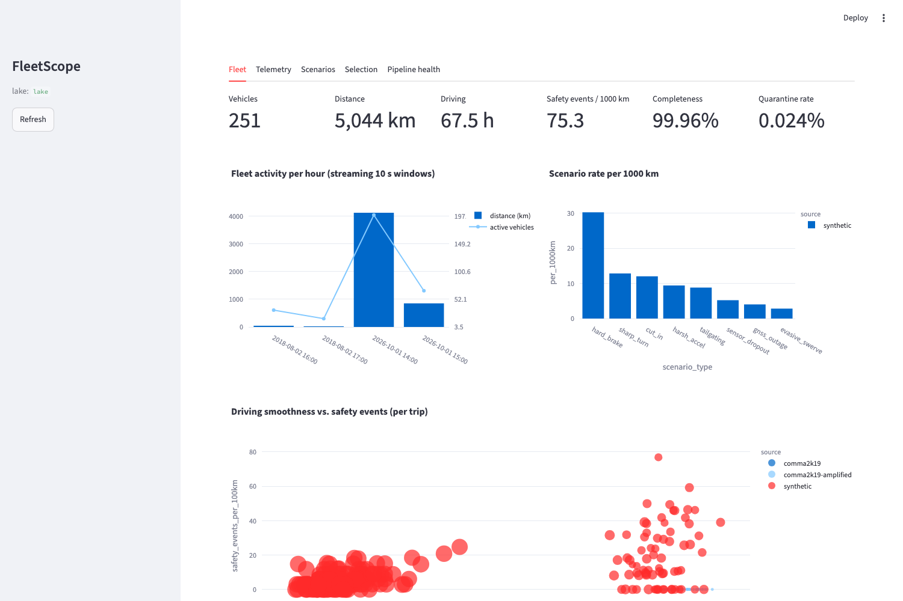
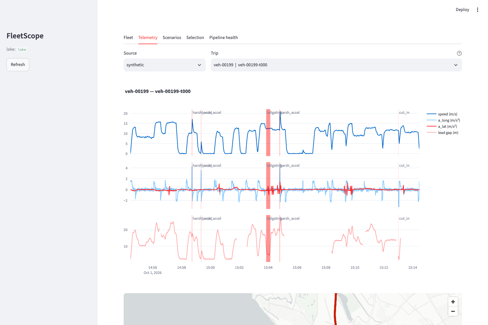
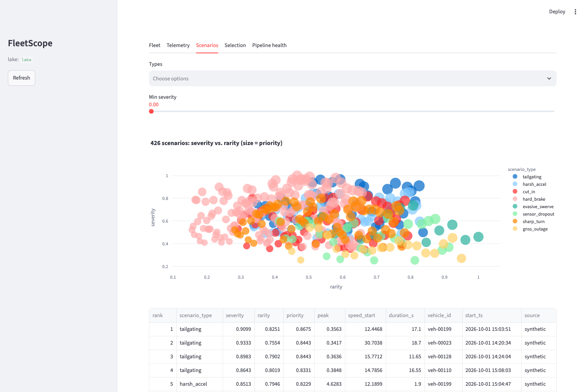
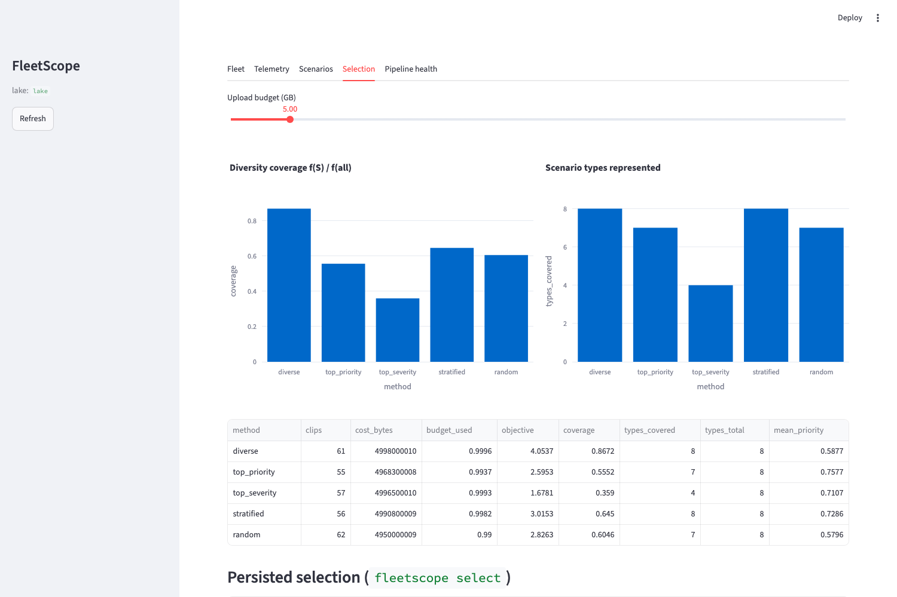
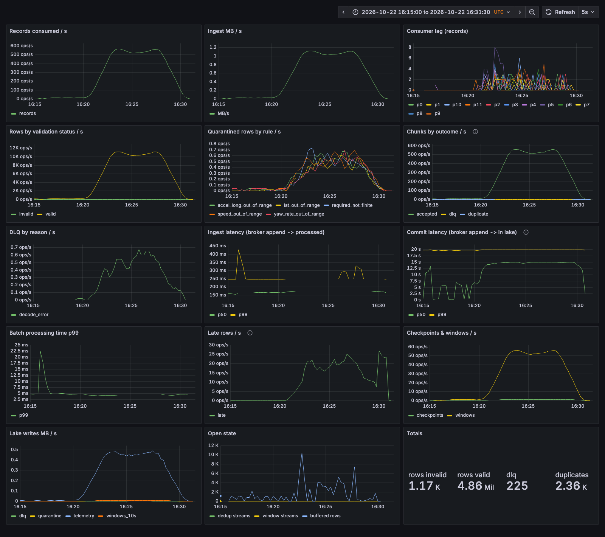

# FleetScope

**Autonomous-vehicle fleet data platform.** It streams high-rate vehicle telemetry through Kafka into an exactly-once, SQL-queryable Parquet lake. From there it mines rare, safety-relevant driving scenarios and chooses which clips to keep under a fixed storage budget.

[](https://github.com/apraba05/fleet-scope/actions/workflows/ci.yml)



## What it does

| Stage | Implementation | How it is verified |
|---|---|---|
| **Sources** | A [comma2k19](https://github.com/commaai/comma2k19) loader (CAN, IMU, GNSS and radar resampled to 20 Hz, boot clock → UTC, device axes → ISO 8855, in-lane radar lead). It can amplify one real drive into many virtual vehicles. A synthetic fleet generator injects scenarios with ground-truth labels. | Loader tests against the vendored real segment |
| **Fleet replay** | Interleaves trips by event time. Injects duplicates, reordering, late chunks, corrupt payloads and invalid samples, and counts each one exactly. Can pace at N× real time. Uses an idempotent `acks=all` zstd producer. | Fault-accounting tests |
| **Streaming ingestion** | One Kafka consumer group, so partitions are the unit of scale-out. Per partition: decode → chunk validation (to DLQ) → dedup on `(vehicle, trip, seq)` → vectorised row validation (to quarantine) → event-time 10 s windows with per-stream watermarks | Unit tests plus property tests |
| **Exactly-once lake** | Hive-partitioned Parquet (`date=/hour=`, event time). Deterministic file names plus an atomic per-partition checkpoint that holds offset and operator state. Readers see only committed files. | `kill -9`, rebalance and crash-at-every-step tests produce a lake **identical** to the crash-free run, on a real broker |
| **SQL** | DuckDB views over the committed snapshot, with partition and row-group pruning | Query benchmarks |
| **Scenario mining** | Detectors for 8 types: hard brake, harsh accel, sharp turn, evasive swerve, cut-in, tailgating, sensor dropout, GNSS outage. Each scenario is scored by severity × rarity, where rarity combines type surprisal with within-type kNN novelty. | Precision and recall against injected ground truth (100%/100% on `clear`; precision 100% on `borderline`) |
| **Budgeted selection** | Type-balanced facility location under a byte budget, solved by cost-benefit lazy greedy plus best singleton, with a **(1−1/e)/2 guarantee** | Brute-force optimality checks; beats top-priority, top-severity, stratified and random baselines |
| **Metrics** | Trip and fleet KPIs in SQL: gap-aware distance, completeness, smoothness percentiles, close following, GNSS availability, events per 1000 km | Hand-computed fixtures; streaming and batch agree within 1% |
| **Observability** | Prometheus metrics (throughput, lag, ingest and commit latency, rejects by reason), a generated Grafana dashboard, and JSONL health snapshots | Live-stack screenshot below |
| **Dashboard** | Streamlit tabs: fleet KPIs, telemetry explorer with scenario overlays, scenario ranking, selection trade-offs, pipeline health | Headless Playwright smoke test in CI |

Measured on a 12-core arm64 laptop ([docs/benchmarks.md](docs/benchmarks.md), regenerated with `make bench`). The workload is 4.86 M samples from 251 vehicles with realistic transport faults:

- **One processor thread ingests about 360k rows/s through Kafka.** The lake matches the expected clean rows exactly: 4,859,033 / 4,859,033.
- **Producer:** about 1.3 M rows/s (130 MB/s) with idempotent `acks=all` and zstd.
- **Mining:** detection and scoring take 0.46 s for 4.86 M rows. All 8 scenario types reach 100% precision and recall on the `clear` fleet.
- **Selection at a 5 GB budget:** the diverse selector captures 0.87 of the coverage objective. Top-priority captures 0.56, top-severity 0.36, stratified 0.65 and random 0.61.

More measured numbers are in [docs/benchmarks.md](docs/benchmarks.md). The design is described in [docs/architecture.md](docs/architecture.md) and [docs/design.md](docs/design.md), and metric definitions are in [docs/metrics.md](docs/metrics.md).

## Quick start

You need Python ≥ 3.11. Docker is needed only for the Kafka path.

```bash
make install                 # .venv with dev + dashboard extras
make demo                    # in-process: replay → lake → mine → select → evaluate (no Kafka)
make dashboard               # http://localhost:8501
```

Run the same pipeline through Kafka, with Prometheus and Grafana:

```bash
make up                      # Kafka (KRaft) + Prometheus :9090 + Grafana :3000
make kafka-demo              # fresh topic, replay, process (metrics on :9108), mine, select
make test-kafka              # exactly-once integration tests against the broker
```

If ports 9090 or 3000 are already taken, override them: `PROMETHEUS_PORT=19090 GRAFANA_PORT=13000 make up`.

### CLI

```bash
fleetscope replay  --vehicles 500 --minutes 30 --comma2k19 data/comma2k19_sample --clones 100 --speedup 10
fleetscope process --metrics-port 9108 --group lake-writers          # run N of these to scale out
fleetscope mine                                                       # scenarios + trip metrics
fleetscope select  --budget-gb 5                                      # diverse selection + baseline comparison
fleetscope sql "SELECT scenario_type, count(*), avg(severity) FROM scenarios GROUP BY 1"
fleetscope evaluate                                                   # precision / recall vs labels
```

## How exactly-once works

```
epoch [a, b) of partition p:
  1. write  telemetry/date=…/hour=…/<topic>-p<p>-<a>-<b-1>.parquet   (tmp + rename, all tables)
  2. commit _checkpoints/<topic>/p<p>.json  {next_offset: b, dedup + window state}   ← atomic
visible  ⇔  end offset < next_offset
restart  ⇒  delete files with start ≥ next_offset, restore state, consume from next_offset
```

The processor is deterministic: validity uses broker timestamps, not the wall clock, and windows close on event time. A replay from the checkpoint therefore regenerates byte-identical files under the same names. Finishing a bounded stream uses a *drain epoch* with its own commit marker. On a rebalance, each partition commits before it is revoked, and a zombie owner is fenced by a compare-and-set on the checkpoint. [docs/design.md](docs/design.md) covers this in full, including known limitations.

## Screenshots

| Telemetry explorer | Scenario ranking |
|---|---|
|  |  |
| **Budgeted selection** | **Grafana: pipeline health** |
|  |  |

## Repository layout

```
src/fleetscope/
  schema.py            wire (msgpack) + Arrow schemas
  sources/             comma2k19 loader + amplification, synthetic fleet with labels
  replay/              interleave, fault injection, pacing, Kafka producer
  stream/              validate, dedup, windows, sink, checkpoint, processor, runner, local
  lake/                committed-file catalog, DuckDB views
  scenarios/           detectors, rarity/priority, evaluation, budgeted selection
  metrics/             trip + fleet KPIs
  observability.py     Prometheus metrics, health snapshots
  cli.py
dashboard/app.py       Streamlit dashboard
infra/                 Prometheus config, Grafana provisioning + generated dashboard
benchmarks/run.py      writes docs/benchmarks.md
tests/                 unit, property, end-to-end and Kafka integration tests
```

## Data

`data/comma2k19_sample/` contains one 60 s segment of the [comma2k19](https://github.com/commaai/comma2k19) dataset (MIT license, © comma.ai; see the `LICENSE` in that directory). To use more of the dataset, download chunks and point `--comma2k19` at them.

## License

MIT
