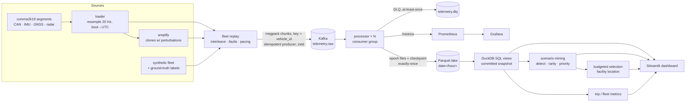

# Architecture



## Components

| Path | Responsibility |
|---|---|
| `sources/comma2k19.py` | Reads raw comma2k19 logs: resamples every signal to 20 Hz, converts boot time to UTC, converts device IMU axes to ISO 8855, and picks the in-lane radar lead. |
| `sources/synthetic.py` | Generates a fleet with known scenarios (hard brake, cut-in, swerve, tailgating, dropouts, GNSS outages) and their ground-truth labels. |
| `replay/fleet.py` | Merges trips by event time. Injects duplicates, reordering, late chunks, corrupt payloads and invalid samples, and counts each fault exactly. Can pace output to N× real time. |
| `replay/producer.py` | Idempotent Kafka producer (`acks=all`, zstd, back-pressure on a full queue). |
| `stream/validate.py` | Chunk-level checks (send the chunk to the DLQ) and vectorised row-level checks (quarantine only the failing samples, with a bitmask of the failed rules). |
| `stream/dedup.py` | Exactly-once chunk admission keyed on `(vehicle, trip, seq)`. State per stream is bounded. |
| `stream/windows.py` | Event-time 10 s tumbling windows with a watermark per stream, allowed lateness, and idle closing. |
| `stream/processor.py` | Runs the per-partition pipeline and batches its outputs into commit epochs. Contains no Kafka code. |
| `stream/checkpoint.py`, `stream/sink.py` | Hive-partitioned Parquet writer and the atomic per-partition checkpoint, which is the commit point. |
| `stream/runner.py` | Kafka consumer loop: positions partitions from lake checkpoints, handles rebalances, fences zombies, forwards to the DLQ, reports lag. |
| `stream/local.py` | In-memory topic and runner. Tests and `fleetscope local` use it to run the same processor without a broker. |
| `lake/catalog.py`, `lake/sql.py` | Lists only committed files and exposes them as DuckDB views. |
| `scenarios/` | Detectors, rarity and priority scoring, evaluation against ground truth, and budgeted selection. |
| `metrics/driving.py` | Trip and fleet KPIs in SQL. Definitions are in [metrics.md](metrics.md). |
| `observability.py` | Prometheus metrics plus JSONL health snapshots in `lake/_ops/`. |
| `cli.py` | `fleetscope replay · process · local · mine · select · evaluate · sql · demo` |

## Data path for one message

1. **Wire.** A `TelemetryChunk` holds one trip's samples for 1 s (20 × 9 signals, columnar), plus a `seq` number. It is MessagePack-encoded and keyed by `vehicle_id`, so a vehicle always maps to one partition and producer order is preserved. Topics use `LogAppendTime`, which makes the record timestamp the broker's ingest time. That timestamp drives the future-skew check and the ingest-latency metric.
2. **Decode and chunk validation.** If a payload is undecodable, has an unknown schema version, has a missing identity, or has columns of mismatched length, it goes to the `dlq` table with its reason, and also to `telemetry.dlq` with a reason header.
3. **Dedup.** A chunk with the same `(vehicle_id, trip_id, seq)` as one already seen is dropped. If a gap stays open longer than the dedup window, the stream's tracking floor moves past it. A chunk that arrives below that floor afterwards is ambiguous: it could be the missing chunk or a duplicate. It is dead-lettered, never guessed.
4. **Row validation.** Rules are vectorised over the whole batch. A failing sample goes to `quarantine` along with a bitmask of every rule it broke; the rest of its chunk is kept. NaN in an optional signal (no GNSS fix, no lead vehicle) is valid and stored as SQL `NULL`.
5. **Windows.** Valid rows update the open 10 s windows for their stream. A window is emitted once that stream's watermark passes the window's end. Rows that arrive later are still written to `telemetry` but are excluded from `windows_10s` and counted as late.
6. **Commit.** Outputs are buffered until the epoch reaches its row or time limit. At that point every file is written under its final, deterministic name, and then the checkpoint (offset + dedup state + window state) is atomically replaced.

## Lake layout

```
lake/
  telemetry/date=2026-10-01/hour=14/telemetry.raw-p003-000000041200-000000048199.parquet
  quarantine/…   dlq/date=…/…   windows_10s/date=…/hour=…/…
  _checkpoints/telemetry.raw/p003.json        # next_offset, drained_at, operator state
  _ops/health-processor-<host>-<pid>.jsonl    # periodic counters for the dashboard
  scenarios/scenarios.parquet  trip_metrics/…  selection/…  ground_truth/…   # batch outputs
```

Rows are partitioned by **event time**, so a late chunk lands in the hour it belongs to. Within an epoch, files are sorted by `(vehicle_id, ts)` and zstd-compressed. Because of that sort, row-group min/max statistics let DuckDB skip most of the data for single-vehicle queries.

## Scaling out

- **Partitions are the unit of parallelism.**
  - Start more `fleetscope process` instances with the same `--group`, and Kafka spreads the partitions across them.
  - All state is per partition and lives in that partition's checkpoint, so the only cost of moving a partition is replaying from its last commit.
- **Rebalances are eager.**
  - On revoke, each partition commits its open epoch before it is released.
  - On a lost assignment (session timeout), state is dropped *without* committing.
  - If the old owner was in fact still alive (a zombie), its next commit finds that the checkpoint's `next_offset` has moved and it stops (`FencedError`). The remaining check-then-rename race is covered under [known limitations](design.md#known-limitations).
- **A shared filesystem is the deployment assumption.**
  - Multiple processors write one lake through a filesystem shared by every processor host (local disk in the demo, or NFS/EFS).
  - On S3, the same protocol works with conditional writes on the checkpoint object (`If-Match`). File names are deterministic and immutable, so data files need no coordination.
